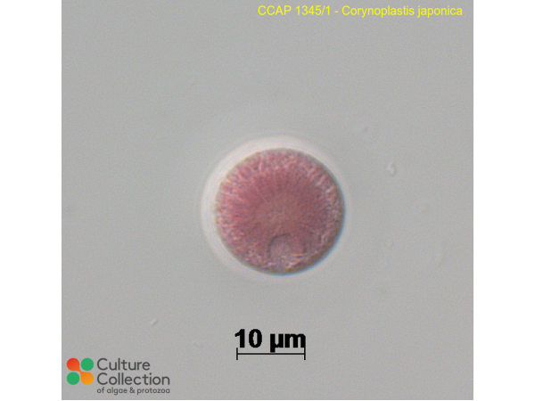

# Lab 3 homework: Plastid genome assembly and annotation for red algae

## What to include for the submission?
1. A word/text file to answer the following questions.
2. GenBank file with gene annotation.

Zip the above documents into a single file, submit through the Canvas assignment page.
---------------------

Included is the assembly graph of the plastid genome of a red alga, *Corynoplastis japonica*. The genome is published in this [paper](http://cell.com/current-biology/fulltext/S0960-9822(17)30499-2), featuring one of the biggest plastid genomes reported so far. The big genome reflects an early evolutionary stage with many cyanobacterial genes still retained in the plastid.

1. Input reads are stored under the shared lab repository ``. It is downloaded from the GenBank SRA reads collection `SRR15114502`. Because the plastid genome is almost 1 Mb in size, we need to provide reference red algae plastid sequences to facilitate the assembly. This is because the default reference databases used in GetOrganelle are angiosperm plastids that are generally smaller in size and lack many genes from the cyanobacterial genome. Based on the manual of GetOrganelle, which flag can you add to supply a seed reference sequence file? (1pt)

2. Now run GetOrganelle with two input readds; assembly kmer size of 65,85,105; 15 rounds of reads extension; plus user-defined seed file `` (provided in Lab3/homework and on GitHub). Type the full command you use to run the program. (1pt)

[The program takes about min to finish using 4 threads on HiperGator. If you cannot get it to work, use the output under the folder on HiperGator or the `` file on GitHub.]

View and resolve this assembly graph in `Bandage`. Then resolve it into a circular structure and answer the following questions.