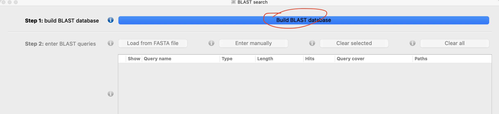
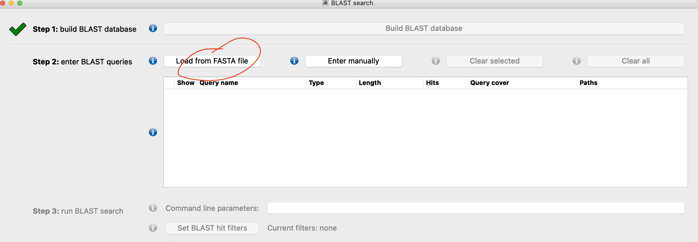
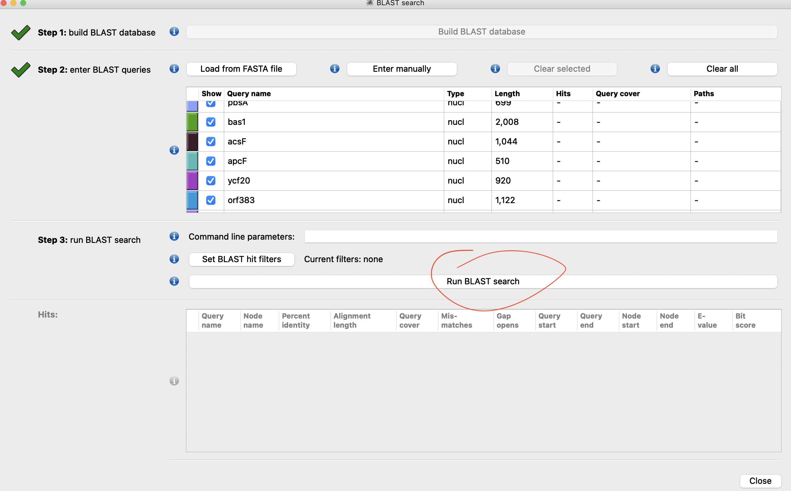
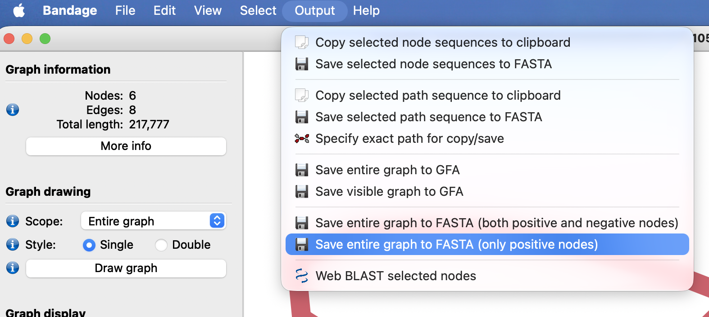

# Lab 3 homework: Plastid genome assembly and annotation for red algae

## What to include for the submission?
1. A word/text file to answer the following questions.
2. A FASTA file of the fully resolved circularized assembly.

Zip the above documents into a single file, submit through the Canvas assignment page.
---------------------

In this exercise, we will assemble the plastid genome of a red alga, *Rhodochaete parvula*. The genome is published in this [paper](http://cell.com/current-biology/fulltext/S0960-9822(17)30499-2). The relatively big genome reflects an early evolutionary stage with many cyanobacterial genes still retained in the plastid.

1. Input reads are stored under the shared lab repository `/blue/bot4935/share/Lab3/Rhodochaete_parvula_fastq`. It is downloaded from the GenBank SRA reads collection [SRR5278930](https://www.ncbi.nlm.nih.gov/sra/SRX2582757[accn]). Because the plastid genome is larger than most typical flowering plant plastid genomes, we need to provide reference red algae plastid sequences to facilitate the assembly. This is because the default reference databases used in GetOrganelle are angiosperm plastids that are generally smaller in size and lack many genes from the cyanobacterial genome. Based on the [manual of GetOrganelle](https://github.com/Kinggerm/GetOrganelle), which flag can you add to supply a seed reference sequence file? (1pt)

2. Now run GetOrganelle with 
- two input reads in `/blue/bot4935/share/Lab3/homework/fastq/`
- assembly kmer size of 65,85,105
- 15 rounds of reads extension
- user-defined seed file `seed.fasta` (provided in /blue/bot4935/share/Lab3/homework and on GitHub)

	Type the full command you use to run the program. (1pt)

$\color{red}{\text{The program takes about 15 min to finish using 4 threads on HiperGator. If you cannot get it to work, use the output under the folder on HiperGator `/blue/bot4935/share/Lab3/homework/Rpa_getorganelle_output`. The assembly graph and screen log file are also available as `Rhodochaete_parvula_embplant_pt.K105.complete.graph1.selected_graph.gfa` and `Rhodochaete_parvula.get_org.log.txt` on GitHub.}}$

3. Based on the log file, what is the read coverage for the plastid assembly? (1pt)

4. View the assembly graph in `Bandage`. This graph is slightly more complex than the graph we saw in class. Click on each node to view the base coverage for each node. How many repeat nodes are there in this graph, and what kind of repeat are they (i.e., direct or inverted repeat)? (1 pt)

5. Since GeSeq is still not working, we will use the built-in BLAST feature of Bandage to annotate the genome. BLAST is a similarity-based approach to identify genomic regions showing homology to candidate query sequences. Follow these steps to answer the question:

a. Download `Rhodochaete_parvula.genes.fas` from GitHub and save it on your laptop

b. In Bandage, click on the `Create/view BLAST search` button on the left, which will lead you to a BLAST search window

c. Click the blue `Build BLAST Database` button

d. In Step 2, click the `Load from FASTA file` to select the `Rhodochaete_parvula.genes.fas` file you just saved on your computer. This set of gene sequences will be BLASTed against the Rhodochaete_parvula genome assembly.

e. Click `Run BLAST search` to run the analysis.

f. Close the BLAST window and go back to the assembly graph view. Now BLAST hits should be colored individually. 

Attach the screenshot of the assembly graph with BLAST hits colored (0.5 pt). Are there any genes in the repeat regions (0.5 pt)? 

6. Resolve this graph into a full circle. Export as fasta (Output > Save entire graph as fasta (only positive nodes)). How big (in exact base pairs) is the resolved genome (1 pt)?

